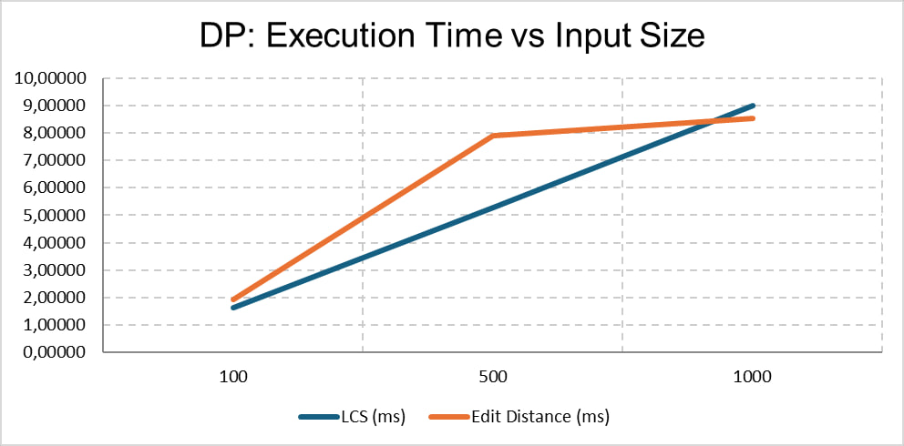
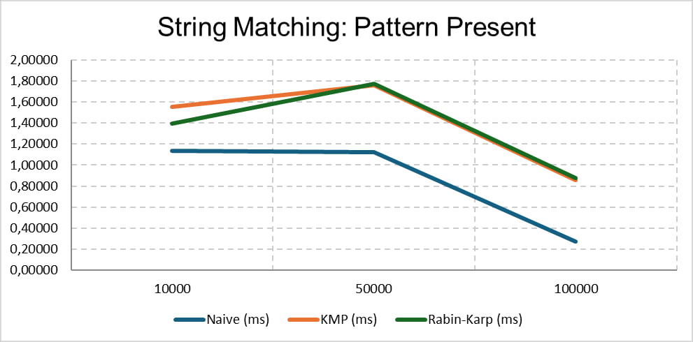
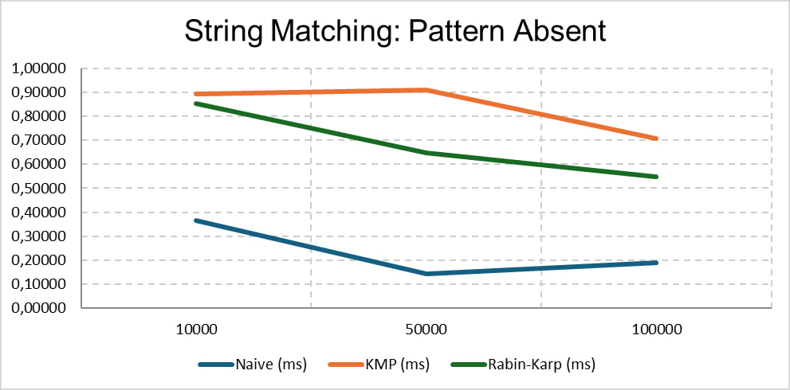
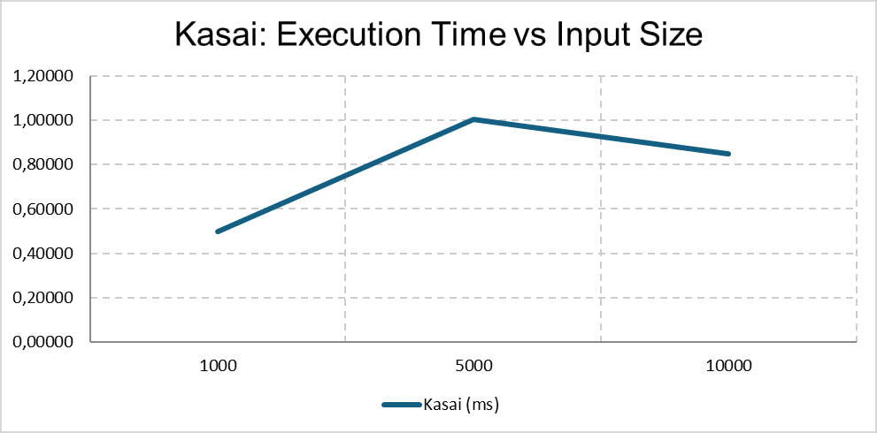

# Assignment 4

## 1. Project Description

This project implements six string algorithms in Java.

## 2. Algorithms

### Dynamic Programming

**LCS (Longest Common Subsequence)**
- Finds the length of the longest common subsequence of two strings.
- Uses a 2D dynamic programming table.

**Edit Distance**
- Finds the minimum number of operations needed to change one string into another.
- Operations: insertion, deletion, substitution.
- Uses a 2D dynamic programming table.

### String Matching

**Naive String Matching**
- Checks every possible position in the text.
- Returns all matching indices.

**KMP**
- Uses an LPS array to avoid repeated comparisons.
- Returns all matching indices.

**Rabin-Karp**
- Uses rolling hash to find patterns.
- Checks characters when hashes match to avoid false results.

**Kasai**
- Builds the LCP array using a given suffix array.
- LCP stores the common prefix lengths of adjacent sorted suffixes.

## 3. Complexity Analysis

| Algorithm | Time Complexity | Space Complexity |
|---|---|---|
| LCS | O(n × m) | O(n × m) |
| Edit Distance | O(n × m) | O(n × m) |
| Naive | O(n × m) worst | O(1) |
| KMP | O(n + m) | O(m) |
| Rabin-Karp | O(n + m) average, O(n × m) worst | O(1) |
| Kasai | O(n) | O(n) |

Here, n and m represent input lengths. Space complexity excludes the returned list of matches.

## 4. Testing

All algorithms were tested in AlgorithmTests.java.

Tests included:
- Identical, different, and empty strings for LCS.
- Insertion, deletion, and substitution for Edit Distance.
- Present, absent, multiple matches, and empty patterns for string matching.

All basic tests passed successfully.

## 5. Experimental Setup

The experiments were performed in Java.

Random strings were generated using Random with letters from A to Z.

Each algorithm was tested 5 times using System.nanoTime().

The average execution time was calculated in milliseconds.

## 6. Experimental Results

### LCS and Edit Distance

| Input Size | LCS (ms) | Edit Distance (ms) |
|---|---|---|
| 100 | 1.64570 | 1.91600 |
| 500 | 5.29676 | 7.89242 |
| 1000 | 8.99156 | 8.54736 |

### String Matching - Present Pattern

| Text Length | Naive (ms) | KMP (ms) | Rabin-Karp (ms) |
|---|---|---|---|
| 10000 | 1.13620 | 1.55590 | 1.39232 |
| 50000 | 1.12210 | 1.75960 | 1.77174 |
| 100000 | 0.27030 | 0.85666 | 0.87834 |

### String Matching - Absent Pattern

| Text Length | Naive (ms) | KMP (ms) | Rabin-Karp (ms) |
|---|---|---|---|
| 10000 | 0.36670 | 0.89366 | 0.85358 |
| 50000 | 0.14270 | 0.90798 | 0.64604 |
| 100000 | 0.19078 | 0.70822 | 0.54862 |

### Kasai Algorithm

| Input Size | Kasai (ms) |
|---|---|
| 1000 | 0.49836 |
| 5000 | 1.00296 |
| 10000 | 0.84866 |

## 7. Discussion

LCS and Edit Distance generally took more time with larger inputs.

Naive String Matching was faster than KMP and Rabin-Karp in these experiments.

KMP has better worst-case time complexity than Naive.

Rabin-Karp uses hashing, but collisions can slow it down.

Kasai has O(n) time complexity.

## 8. How to Run

Run:
- Main.java for basic examples.
- AlgorithmTests.java for correctness tests.
- Experiment.java for LCS and Edit Distance.
- StringExperiment.java for string matching.
- KasaiExperiment.java for Kasai.

## 9. Conclusion

All six algorithms were implemented in Java and tested.

The experiments show that theoretical complexity and actual execution time can differ.

